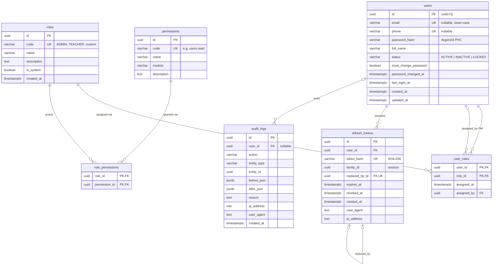

# ERD — Phase 1: identity, access & audit

Migrations: `001_identity_access`, `002_audit_logs`. Source of truth: `apps/api/prisma/schema/*.prisma`.

**Constraints not visible in the diagram** (hand-written in migration SQL):

- `users`: `CHECK (email IS NOT NULL OR phone IS NOT NULL)`, `CHECK (email = lower(email))`, status CHECK.
- `audit_logs`: triggers block `UPDATE`, `DELETE` and `TRUNCATE` (append-only).
- Delete rules: `user_roles`/`audit_logs` → users `RESTRICT`; `role_permissions` → roles `CASCADE`;
  `refresh_tokens` → users `CASCADE`.
