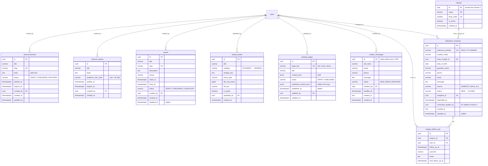

# ERD — Phase 2: public website, CMS & admission enquiries

Migrations: `003_public_cms`, `004_admission_enquiries`. Source of truth: `apps/api/prisma/schema/{cms,admissions}.prisma`.
`users` is from Phase 1 (only the relationships are shown here).

**Hand-written constraints** (in migration SQL): status/source/category CHECKs, `announcements` and
`internal_notices` visibility window CHECK, `events.ends_at >= starts_at`, `media_assets.file_size_bytes > 0`,
`classes.level_order >= 0`, and the `admission_enquiry_number_seq` sequence. All new foreign keys use
`RESTRICT` (no cascade deletes).
