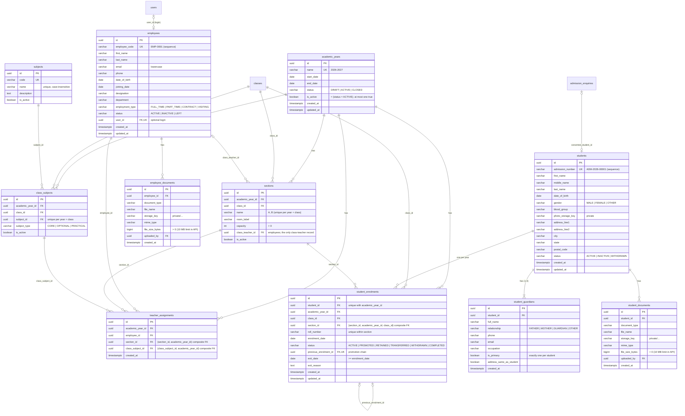

# ERD: Phase 3 (academic structure, staff and students)

Migrations: `005_academic_years`, `006_academic_structure`, `007_employees`, `008_teacher_assignments`, `009_students_enrolments`, `010_subject_name_unique`.
Source of truth: `apps/api/prisma/schema/{academics,staff,students}.prisma`.
`users`, `classes` and `admission_enquiries` come from earlier phases; only their relationships are shown here.

## Database rules Prisma can't express (hand-written SQL in the migrations)

| Rule                                                                                                                     | Where                              |
| ------------------------------------------------------------------------------------------------------------------------ | ---------------------------------- |
| `end_date > start_date`, status values, `is_active = (status = 'ACTIVE')`                                                | `academic_years` CHECKs            |
| At most one current year: `UNIQUE (is_active) WHERE is_active`                                                           | `academic_years_single_active_idx` |
| Subject names unique regardless of case: `UNIQUE (lower(name))` (migration 010)                                          | `subjects_name_key`                |
| `capacity > 0`                                                                                                           | `sections` CHECK                   |
| `subject_type` values                                                                                                    | `class_subjects` CHECK             |
| Status, employment type, lowercase email                                                                                 | `employees` CHECKs                 |
| `EMP-0001` numbering                                                                                                     | `employee_code_seq`                |
| Status, gender, blood group values                                                                                       | `students` CHECKs                  |
| `ADM-YYYY-NNNNN` numbering                                                                                               | `student_admission_number_seq`     |
| Relationship values; at most one primary guardian: `UNIQUE (student_id) WHERE is_primary` (the API ensures at least one) | `student_guardians`                |
| Status values, `exit_date >= enrolment_date`                                                                             | `student_enrolments` CHECKs        |
| An enrolment's class always matches its section (composite FK on section, year and class)                                | `student_enrolments` FK            |
| A teacher assignment's section and subject belong to the same year (composite FKs)                                       | `teacher_assignments` FKs          |
| File size > 0 (the 10 MB / 2 MB upload limits are enforced by the API)                                                   | `*_documents` CHECKs               |
