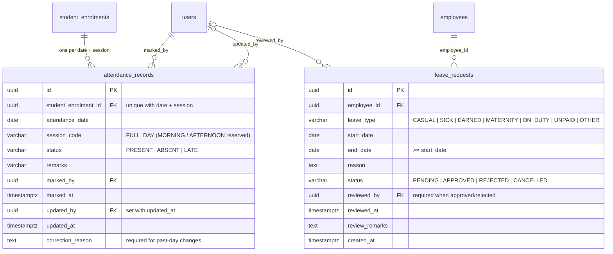

# ERD: Phase 4 (attendance and teacher leave)

Migrations: `011_attendance`, `012_leave`. Source of truth: `apps/api/prisma/schema/attendance.prisma`.
`users`, `employees` and `student_enrolments` come from earlier phases; only their relationships are shown here.

## Database rules Prisma can't express (hand-written SQL in the migrations)

| Rule                                                                                     | Where                                           |
| ---------------------------------------------------------------------------------------- | ----------------------------------------------- |
| Status values `PRESENT / ABSENT / LATE`                                                  | `attendance_records_status_chk`                 |
| Session values `FULL_DAY / MORNING / AFTERNOON`                                          | `attendance_records_session_chk`                |
| `updated_by` and `updated_at` are set together                                           | `attendance_records_updated_pair_chk`           |
| One record per enrolment, date and session                                               | `attendance_records_enrolment_date_session_key` |
| `end_date >= start_date`; leave type and status values                                   | `leave_requests_*_chk`                          |
| Approved/rejected rows have a reviewer and review time                                   | `leave_requests_reviewed_chk`                   |
| No overlapping pending/approved requests per employee (`EXCLUDE USING gist`, btree_gist) | `leave_requests_no_overlap`                     |

Attendance and leave rows are never deleted (`ON DELETE RESTRICT` on every foreign key); corrections update the row and are written to `audit_logs`.
