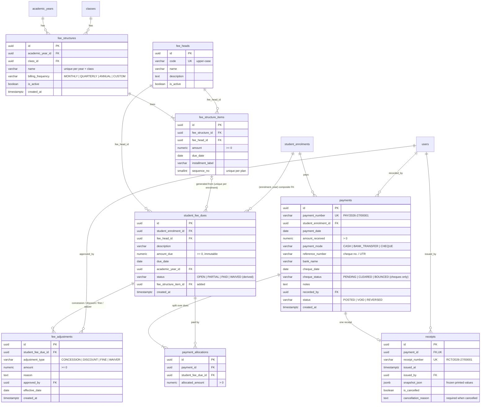

# ERD: Phase 5 (fees, manual payments and receipts)

Migrations: `013_fee_configuration`, `014_student_fee_ledger`, `015_payments_receipts`. Source of truth: `apps/api/prisma/schema/fees.prisma`.
`academic_years`, `classes`, `student_enrolments` and `users` come from earlier phases.

## Database rules Prisma can't express (hand-written SQL in the migrations)

| Rule                                                                                        | Where                                                      |
| ------------------------------------------------------------------------------------------- | ---------------------------------------------------------- |
| Amount, status, type and frequency checks                                                   | `*_chk` constraints                                        |
| Cheque details present exactly for cheque payments                                          | `payments_cheque_chk`                                      |
| Cancelled receipts have a reason                                                            | `receipts_cancel_reason_chk`                               |
| Payments: no delete; only status / cheque status / notes may change; VOID/REVERSED is final | `payments_guard_update`, `payments_no_delete`              |
| Allocations and adjustments: no update, no delete                                           | `fees_block_update`, `fees_block_delete`                   |
| Receipts: number and snapshot frozen; cancel once; no delete                                | `receipts_guard_update`, `receipts_no_delete`              |
| Dues: billed amount, fee head and student never change                                      | `student_fee_dues_guard_update`                            |
| A due's year equals its enrolment's year                                                    | composite FK → `student_enrolments (id, academic_year_id)` |
| Generated dues never duplicated                                                             | `UNIQUE (student_enrolment_id, fee_structure_item_id)`     |
