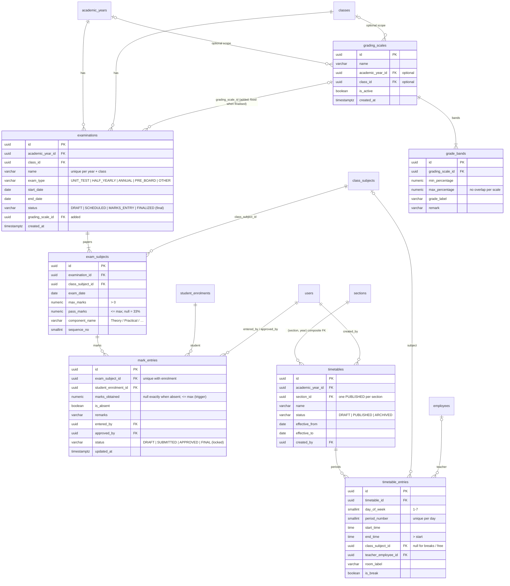

# ERD: Phase 6 (examinations, results and timetable)

Migrations: `016_examinations`, `017_grading`, `018_timetable`. Source of truth: `apps/api/prisma/schema/exams.prisma`.
`academic_years`, `classes`, `class_subjects`, `sections`, `student_enrolments`, `employees` and `users` come from earlier phases.

## Database rules Prisma can't express (hand-written SQL in the migrations)

| Rule                                                     | Where                                                                   |
| -------------------------------------------------------- | ----------------------------------------------------------------------- |
| Type / status / date checks                              | `examinations_*_chk`                                                    |
| A finalised exam can't change or be deleted              | `examinations_guard` trigger                                            |
| `max_marks > 0`, `0 <= pass_marks <= max_marks`          | `exam_subjects_*_chk`                                                   |
| One row per subject + component per exam                 | `exam_subjects_component_key` (expression index)                        |
| Absent ⇔ no marks; marks ≥ 0                             | `mark_entries_absent_chk`                                               |
| Marks ≤ the paper's maximum; FINAL marks locked          | `mark_entries_guard` trigger                                            |
| Bands within 0–100 and non-overlapping                   | `grade_bands_range_chk`, `grade_bands_no_overlap` (btree_gist)          |
| Bands of a scale used by a finalised exam are frozen     | `grade_bands_guard` trigger                                             |
| One published timetable per section                      | `timetables_one_published_idx`                                          |
| Day 1–7, end after start, breaks have no subject/teacher | `timetable_entries_*_chk`                                               |
| Teacher clashes across published timetables              | API (`TimetableService.clashes`) under an advisory lock when publishing |
