# ERD: Phase 7 (school operations)

Migrations: `019_transport`, `020_complaints_meetings`, `021_inventory`, `022_payroll`, `023_certificates_idcards`. Source of truth: `apps/api/prisma/schema/operations.prisma`, `payroll.prisma` and `certificates.prisma`.
`students`, `student_enrolments`, `employees`, `academic_years` and `users` come from earlier phases.

```mermaid
erDiagram
    vehicles |o--o{ transport_routes : "vehicle"
    employees |o--o{ transport_routes : "driver / attendant"
    transport_routes ||--o{ route_stops : "ordered stops"
    transport_routes ||--o{ student_transport : "riders"
    route_stops |o--o{ student_transport : "(stop, route) composite FK"
    student_enrolments ||--o{ student_transport : "date range"
    users ||--o{ complaints : "created_by / assigned_to"
    student_enrolments ||--o{ parent_teacher_meetings : "student"
    employees ||--o{ parent_teacher_meetings : "teacher"
    inventory_categories ||--o{ inventory_items : "items"
    payroll_runs ||--o{ payroll_records : "one per employee"
    employees ||--o{ payroll_records : "employee"
    payroll_records ||--o{ payroll_items : "lines"
    salary_components ||--o{ payroll_items : "component"
    users ||--o{ payroll_runs : "created_by / approved_by"
    certificate_templates ||--o{ certificate_issues : "template"
    students ||--o{ certificate_issues : "student"
    student_enrolments |o--o{ certificate_issues : "enrolment"
    id_card_templates ||--o{ id_card_batches : "design"
    academic_years |o--o{ id_card_batches : "year"

    vehicles {
        uuid id PK
        varchar registration_number "unique, upper-case"
        varchar vehicle_type
        smallint capacity "> 0"
        date insurance_expiry
        date permit_expiry
        varchar status "ACTIVE | INACTIVE"
    }
    transport_routes {
        uuid id PK
        varchar name "unique (case-insensitive)"
        uuid vehicle_id FK
        uuid driver_employee_id FK
        uuid attendant_employee_id FK
        boolean is_active
    }
    route_stops {
        uuid id PK
        uuid route_id FK "unique name per route"
        varchar name
        time pickup_time
        time drop_time
        smallint sequence_no "> 0"
    }
    student_transport {
        uuid id PK
        uuid student_enrolment_id FK "no overlapping dates (exclusion)"
        uuid route_id FK
        uuid route_stop_id FK
        date start_date
        date end_date "null = ongoing"
        uuid created_by FK
    }
    complaints {
        uuid id PK
        varchar reference_number "CMP-YYYY-00001"
        varchar category
        varchar subject
        text description
        varchar status "OPEN | IN_PROGRESS | RESOLVED | CLOSED"
        uuid assigned_to FK
        text resolution_notes "required when resolved/closed"
        timestamptz resolved_at "added"
    }
    parent_teacher_meetings {
        uuid id PK
        uuid student_enrolment_id FK
        uuid teacher_employee_id FK "one scheduled meeting per teacher per time"
        timestamptz meeting_at
        varchar venue
        text purpose
        varchar status "SCHEDULED | COMPLETED | CANCELLED"
        text notes
    }
    inventory_categories {
        uuid id PK
        varchar name "unique (case-insensitive)"
    }
    inventory_items {
        uuid id PK
        uuid category_id FK
        varchar asset_code "unique, upper-case (AST-00001)"
        varchar name
        numeric quantity ">= 0"
        varchar location
        varchar condition_status "GOOD | NEEDS_REPAIR | DAMAGED | DISPOSED"
        date purchase_date
        numeric purchase_cost ">= 0"
    }
    salary_components {
        uuid id PK
        varchar name "unique (case-insensitive)"
        varchar component_type "EARNING | DEDUCTION"
        boolean is_active
        smallint sort_order "added"
    }
    payroll_runs {
        uuid id PK
        date period_start "1st of month, unique"
        date period_end "last day of that month"
        varchar status "DRAFT | APPROVED | PAID (final, trigger)"
        uuid approved_by FK
        timestamptz paid_at
    }
    payroll_records {
        uuid id PK
        uuid payroll_run_id FK "unique with employee"
        uuid employee_id FK
        numeric gross_amount
        numeric deduction_amount
        numeric net_amount "= gross - deductions, >= 0"
    }
    payroll_items {
        uuid id PK
        uuid payroll_record_id FK "unique with component"
        uuid salary_component_id FK
        varchar component_name "copy (added)"
        varchar component_type "copy (added)"
        numeric amount ">= 0"
    }
    certificate_templates {
        uuid id PK
        varchar code "TC | BONAFIDE | CHARACTER | …"
        varchar name
        text template_html "plain text with placeholders"
        boolean is_active
    }
    certificate_issues {
        uuid id PK
        varchar certificate_number "TC/2026/0001, unique"
        uuid template_id FK
        uuid student_id FK
        uuid student_enrolment_id FK
        date issued_on
        jsonb snapshot "frozen wording; row immutable (trigger)"
    }
    id_card_templates {
        uuid id PK
        varchar name
        varchar audience "STUDENT | STAFF"
        jsonb layout
    }
    id_card_batches {
        uuid id PK
        uuid template_id FK
        uuid academic_year_id FK
        jsonb filters "added: sectionIds"
        int card_count
        uuid created_by FK
    }
```

## Database rules Prisma can't express (hand-written SQL in the migrations)

| Rule                                                            | Where                                                                                                                       |
| --------------------------------------------------------------- | --------------------------------------------------------------------------------------------------------------------------- |
| Status, category, type and condition values                     | `*_status_chk`, `*_category_chk`, `*_type_chk`, `*_condition_chk`                                                           |
| Case-insensitive unique names                                   | `transport_routes_name_key`, `route_stops_route_id_name_key`, `inventory_categories_name_key`, `salary_components_name_key` |
| One route at a time per student                                 | `student_transport_no_overlap` (btree_gist exclusion)                                                                       |
| A resolved/closed complaint has notes                           | `complaints_resolution_chk`                                                                                                 |
| No double-booked teacher                                        | `parent_teacher_meetings_teacher_employee_id_meeting_at_key` (partial)                                                      |
| A payroll run is exactly one calendar month                     | `payroll_runs_period_chk`                                                                                                   |
| DRAFT ⇄ APPROVED → PAID; paid is final; only drafts are deleted | `payroll_runs_guard` trigger                                                                                                |
| Records and lines change only while the run is a draft          | `payroll_lines_guard` trigger (records and items)                                                                           |
| `net = gross − deductions`, nothing negative                    | `payroll_records_amounts_chk`, `payroll_items_amount_chk`                                                                   |
| Issued certificates are never changed or deleted                | `certificate_issues_guard` trigger                                                                                          |
| Reference and asset numbers                                     | `complaint_reference_seq`, `inventory_asset_code_seq`                                                                       |

The demo-data tool's `demo:clear` is the only thing that deletes protected rows, using the transaction-local `app.allow_protected_delete` switch introduced in Phase 6.
